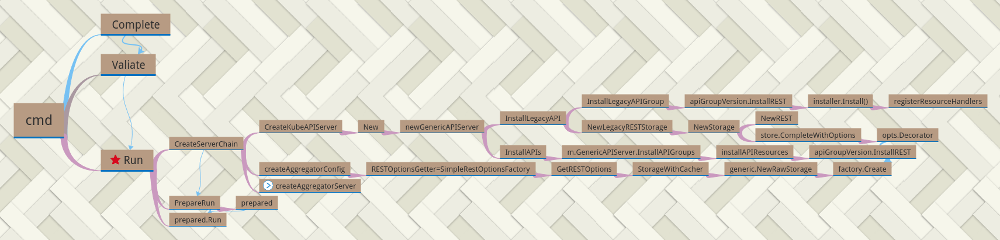

#### 需要知道

`go-restful`  
`cobra`

`kubernetes`的库使用`cobra`，所以一般都是经过`Complete`、`Valiate`、`Run`

### need to know

  * apiserver的启动以及启动组件
  * apiserver的restful uri注册以及资源对应
  * apiserver的存储(etcd3)

### graph

